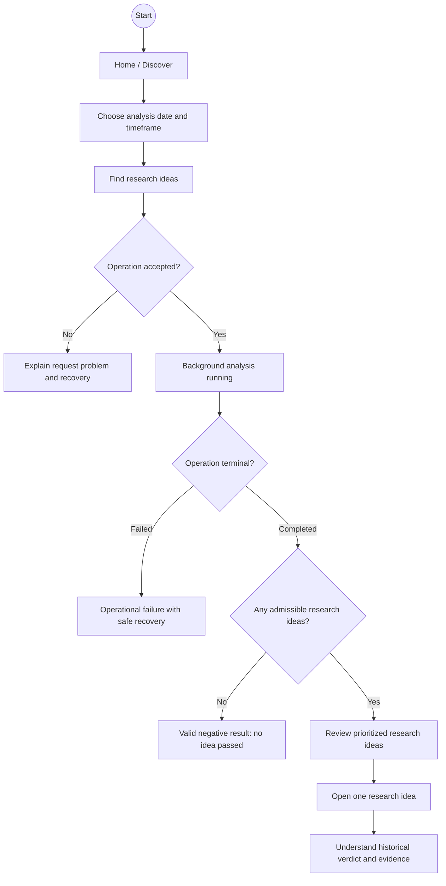
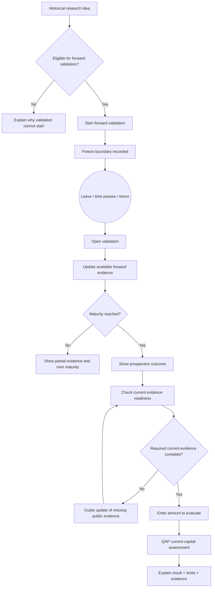
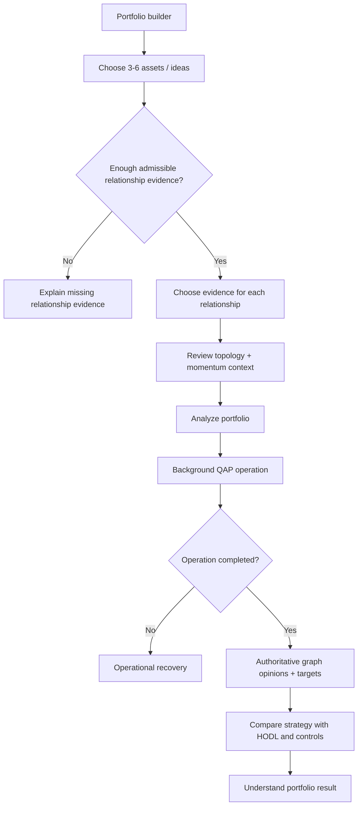
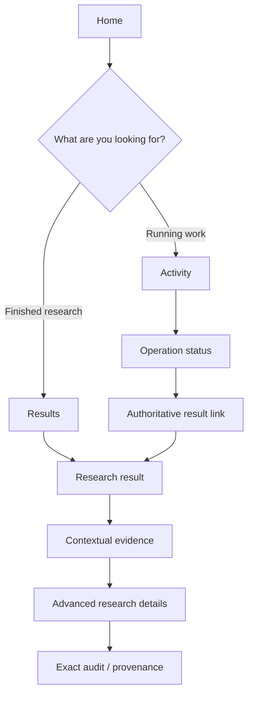

# QAP Human-Centered Workbench UX Investigation

Update context — 2026-08-19
Trigger: Slice 4 is complete on `main` and the next product goal is to make the workbench understandable to stakeholders/users who are not developers or professional traders.
Purpose: Replace implementation-oriented UX assumptions with an evidence-backed task model, user journeys, user flows, cognitive-walkthrough findings, terminology mapping, and information-architecture hypotheses before changing the application shell.
Impact: Establishes the design input for Phase 16. It does not change QAP scientific/economic authority, the seven-command mutation surface, artifact semantics, or live-capital boundaries.
Evidence: `main` at `62416cc`; Slice-4 result record; current React routes/components; deterministic local fixture rendered through agent-browser; existing Phase-14/15/Slice-4 plans.

Later design authority — 2026-08-19: the user explicitly authorized the Phase-17 Product Layer design after a second investigation of clean-install operation, market-data acquisition, asset admission, longitudinal refresh, current-evidence collection, and real-user product comprehension. The Phase-16 IA/terminology in this document remains important historical evidence, but its `Home / Discover / Validate / Portfolios / Results / Activity` baseline is superseded for future Product Layer implementation by `docs/superpowers/specs/2026-08-19-qap-product-layer-design.md` and `docs/plans/17-product-layer-market-data-and-research-lifecycle.md`.

## 1. Investigation scope

This investigation treats the completed Slice-4 application as the current truth and evaluates it from the perspective of a user who:

- understands ordinary investment/portfolio language but is not assumed to know QAP internals;
- is not expected to know scanner implementation vocabulary, model-family identifiers, artifact hashes, exchange-symbol formatting, or research orchestration mechanics;
- needs to understand what the system found, why it matters, what happened later, what can be combined into a portfolio, and where the evidence came from;
- must not be encouraged to interpret research evidence as live-trading authority.

The investigation does **not** invent demographics, personas, conversion rates, abandonment percentages, or usage analytics that QAP has not measured.

## 2. Methods used

The investigation combines:

1. current-route and component inventory on `main`;
2. task analysis of the primary Slice-4 workflows;
3. user journey mapping across sessions;
4. happy-path task flows and branched user flows;
5. cognitive walkthrough questions from a novice/operator perspective;
6. heuristic evaluation focused on visibility, terminology, error prevention, recognition over recall, consistency, and progressive disclosure;
7. information-architecture review of the current navigation and root route;
8. rendered inspection of the deterministic local workbench with agent-browser.

The local rendered walkthrough inspected the current Discovery, Scan Detail, Candidate Detail, Baskets, Prospective navigation, and Operations navigation against the deterministic Slice-4 fixture.

## 3. Current application inventory

The existing route architecture is functionally complete and should not be confused with the future user-facing information architecture.

| Current route | Current role | User-facing concern |
|---|---|---|
| `/` | Research Runs list | Starts at an evidence ledger rather than a user goal or resume point |
| `/scanner` | Discovery command + completed scans | Exposes scanner protocol and advanced operator inputs in the primary layer |
| `/scanner/:scanId` | Scan detail | Shows momentum, all candidate trials, universe evidence |
| `/candidate/:scanId/:candidateId` | Candidate detail | Strong lineage, but raw research-state vocabulary dominates |
| `/prospective` | Forward cohort list | Uses the implementation term `Prospective` / cohort directly |
| `/prospective/:cohortId` | Forward evidence + capture + qualification | Exposes orchestration, market-data, and exact evidence controls together |
| `/baskets` | Local basket draft | Requires source scan, horizon, resolution, assets, and relationship-rule selection |
| `/baskets/:basketId` | Basket result | Correctly separates pre-run topology from post-QAP authoritative results |
| `/operations` | Operation center | Correctly keeps operational state separate from scientific result |
| `/operations/:operationId` | Operation detail | Strong failure/result boundary, but labels remain system-oriented |
| `/experiments/*` | Research-run evidence | Appropriate as a deeper evidence destination |
| `/portfolio/*` | Portfolio economics | Appropriate as a deeper evidence destination |
| `/pair/*` | Pair evidence | Appropriate as a deeper evidence destination |
| `/paper-operations/*` | Forward-paper evidence | Specialist/audit surface, not an obvious primary novice destination |

## 4. Current strengths to preserve

The redesign must preserve these existing strengths rather than trading correctness for friendliness:

- React is presentation-only; research and economic truth remain backend/artifact owned.
- Negative evidence remains visible.
- Operation completion is distinct from scientific success/rejection.
- The browser does not manufacture basket targets before ordinary QAP replay.
- The mutation surface remains finite and domain-specific.
- Reads remain available while the one admitted mutation is active.
- The application is local-only/single-operator and has no live-capital authority.
- Existing evidence routes allow exact scientific/audit inspection.
- Accessibility, keyboard, responsive, TypeScript, component, E2E, and rendered acceptance foundations already exist.

## 5. Primary UX diagnosis

QAP is currently a **good expert/operator console**. It is not yet a good first-contact research product for the stated user profile.

The central problem is not visual quality. It is that the primary presentation frequently asks users to understand implementation concepts before they can understand the research outcome.

Examples visible in the current UI include:

- `UTC as-of`;
- `forensic`;
- `manual replay candidate IDs`;
- `deep_replay_survivor` / `deep_replay_rejected`;
- `model_source_unavailable`;
- `Prospective cohort`;
- `Advance cohort` / `Through UTC`;
- `L1`, `shallow depth`, `venue symbol`, base/quote asset;
- checkpoint identifiers;
- `q_safe_buy` / `q_safe_sell`;
- source scan and decision resolution in the basket builder.

These concepts are legitimate research/audit evidence. The problem is their position in the information hierarchy.

## 6. State semantics that the UX must keep separate

QAP needs three independent visual/state dimensions. They must never collapse into one red/green success convention.

### 6.1 Operational state

```text
running | completed | failed | interrupted
```

This answers: **Did the requested computer operation execute?**

### 6.2 Evidence state

Examples:

```text
valid | invalid | complete | incomplete | unavailable
```

This answers: **Is the evidence present and admissible?**

### 6.3 Research/economic result

Examples:

```text
deep_replay_survivor
deep_replay_rejected
research_only
small_capacity
tradable_now
basket_development_survivor
basket_development_rejected
```

This answers: **What did the research evidence conclude?**

A completed operation that produces a valid rejected basket is a successful user task and valid evidence with a negative research result. The redesigned visual system must make that distinction obvious.

## 7. Task analysis

### Task A — Orient or resume work

**User goal:** Understand where to start or continue.

**Current behavior:** `/` opens Research Runs. The primary navigation is `Discovery / Prospective / Baskets / Research runs / Operations / Paper operations`.

**Knowledge currently required:** User must already know which QAP subsystem corresponds to their intent.

**Observed friction:** Implementation-domain navigation is presented before a goal-oriented orientation layer.

**Target behavior:** A start surface should answer:

- Find new research ideas.
- Continue an idea being validated over time.
- Build/analyze a portfolio from existing evidence.
- Review results or background activity.

### Task B — Find a research idea

**User goal:** Find relationships worth inspecting.

**Current behavior:** User supplies an exact UTC as-of timestamp, chooses `short/medium/swing`, optionally uses manual pin/forensic controls, may paste candidate IDs, then launches a scan.

**Knowledge currently required:** Timestamp format, horizon terminology, pin semantics, forensic semantics, candidate IDs for manual replay.

**Observed friction:** Advanced research controls occupy the same hierarchy as the normal scan command. Completed scan detail then presents a dense candidate-trial table; the rendered deterministic example showed 54 trials, including valid, invalid, promoted, rejected, unattempted, and one survivor.

**Target behavior:** Primary action should be expressed as `Find research ideas`. Date/timeframe selection remains, but protocol/debug/manual replay controls move under `Advanced research controls`. Results should prioritize human-readable research ideas and explain why an item was interesting/rejected before exposing raw trial taxonomy.

### Task C — Understand one research idea

**User goal:** Determine what QAP found and whether the historical evidence passed its declared controls.

**Current behavior:** Candidate Detail leads with `scout valid`, `deep_replay_survivor`, `manual / pinned lineage`, a full candidate ID, graph admission text, model/template/resolution/orientation, scout proxy, promotion state, and QAP links.

**Knowledge currently required:** Candidate/trial terminology, replay terminology, control semantics, model identifiers.

**Observed friction:** Exact provenance appears before the plain-language result.

**Target behavior:** Lead with pair, evidence period, plain-language historical verdict, what it was compared against, and the next valid action. Move IDs/model implementation details into `Research details` / `Exact evidence` disclosure.

### Task D — Validate an idea over later evidence

**User goal:** See whether a historically interesting idea survives genuinely later evidence.

**Current behavior:** User freezes a cohort using a timestamp, navigates to a prospective cohort, enters a `Through UTC` timestamp, launches an advance operation, then later returns to inspect checkpoint outcome.

**Knowledge currently required:** `freeze`, `cohort`, exact temporal semantics, maturity/checkpoint behavior.

**Observed friction:** Freeze and advance can look like two steps in one immediate wizard, even though the scientific meaning depends on a real information boundary across time/sessions.

**Target behavior:** Present the journey as `Start forward validation` followed by `Later evidence` with a visible freeze boundary. The fixed horizon maturity remains backend-owned. The interface should encourage leave/return/resume rather than imply the user selects an arbitrary future-test duration.

### Task E — Evaluate current evidence for a hypothetical capital amount

**User goal:** Ask whether current public evidence supports a stated amount under QAP's research rules.

**Current behavior:** The user must select checkpoint, enter qualification as-of, enter capital, and may separately need to capture L1/depth/metadata using venue symbol and base/quote inputs.

**Knowledge currently required:** Market-data capture kinds, exchange symbol syntax, checkpoint identity, current-evidence completeness, capacity terminology.

**Observed friction:** This is the largest cognitive-load hotspot. A non-expert can reach the page but may not know which capture inputs are missing or how they relate to qualification.

**Target behavior:** Show an evidence-readiness checklist for the selected idea/market, guide the user to update missing public evidence, then ask for `Amount to evaluate`. QAP remains the classifier. The user does not manually accept/reject the idea.

### Task F — Build and analyze a portfolio

**User goal:** Combine several research ideas and see whether they work together under one inventory.

**Current behavior:** User chooses source scan, venue, horizon, decision resolution, 3–6 assets, then one admitted candidate rule per relationship before running QAP.

**Knowledge currently required:** Scan identity, resolution compatibility, relationship-rule taxonomy, indirect/scout-only distinction.

**Observed friction:** The basket builder is scientifically correct but closer to a research configuration form than a portfolio-design workspace.

**Target behavior:** Let the user begin from selected research ideas/assets, see an evidence-backed topology, choose among admissible relationship ideas in plain language, then `Analyze portfolio`. Source scan/resolution/rule IDs remain inspectable advanced evidence.

### Task G — Understand a portfolio result

**User goal:** Know whether the combined strategy improved on the declared controls, what target/result QAP produced, and why.

**Current behavior:** Basket Detail correctly shows authoritative post-run graph decision, benchmark ladder, bridge residue, and links to experiment/portfolio evidence.

**Observed friction:** The underlying structure is strong; the opportunity is to make the verdict and causal boundary more visually dominant while keeping exact evidence secondary.

**Target behavior:** Verdict first, benchmark comparison second, graph/target explanation third, then detailed execution/evidence.

### Task H — Review activity and evidence history

**User goal:** Find running/finished work and navigate to its authoritative result.

**Current behavior:** Operations is technically correct and differentiates operational failure from scientific inference.

**Observed friction:** Operation kinds and result link labels are system-oriented. `Research runs` and `Paper operations` are also top-level navigation items, making activity/evidence architecture feel fragmented.

**Target behavior:** `Activity` owns background-task status. `Results` owns finished research evidence. Technical operation details remain available from Activity.

## 8. Canonical user journeys

### Journey 1 — Find and understand a research idea



`K` is not an application error. It is a valid scientific outcome.

### Journey 2 — Validate later evidence across sessions



### Journey 3 — Build and evaluate a portfolio



### Journey 4 — Resume or audit prior work



## 9. Cognitive walkthrough findings

Severity scale used here:

- **S1** — minor friction; user can proceed with little risk;
- **S2** — recurring confusion or inefficiency;
- **S3** — major barrier for the target user profile;
- **S4** — likely to produce materially wrong interpretation or block task completion.

| Severity | Finding | Evidence | Recommendation |
|---|---|---|---|
| S3 | Root route does not orient a novice | `/` is Research Runs | Replace root presentation with goal/resume home; keep runs reachable under Results |
| S3 | Primary navigation mirrors subsystems | Discovery / Prospective / Baskets / Research runs / Operations / Paper operations | Test goal-oriented IA such as Discover / Validate / Portfolios / Results / Activity |
| S3 | Discovery exposes advanced controls as normal inputs | forensic, manual pin, manual replay IDs are visible in the main command card | Default simple scan; put manual/forensic/replay controls behind Advanced research controls |
| S3 | Scan detail is trial-first, not idea-first | Rendered fixture showed 54 mixed trial rows | Provide prioritized idea/result summary before the complete trial ledger |
| S3 | Candidate Detail uses internal status codes as the verdict | `deep_replay_survivor`, `manual_promoted`, exact IDs | Human verdict first; exact state and provenance second |
| S4 | Prospective current-evidence workflow requires implementation knowledge | capture kind, venue symbol, base/quote, checkpoint, timestamps | Evidence-readiness workflow that guides missing capture while preserving finite backend commands |
| S3 | Freeze/advance phrasing hides the scientific time boundary | Actions appear together as immediate controls | Visualize the freeze boundary and cross-session waiting/resume state |
| S3 | Current qualification language can be mistaken for trading authority | `tradable_now` exists while Phase 12 is live `NO-GO` | Plain-language research assessment plus persistent no-live-authority wording; exact state remains visible in audit |
| S3 | Basket builder starts from source/configuration mechanics | scan, venue, horizon, resolution, candidate rule dropdowns | Start from research ideas/assets; move source/configuration metadata into advanced evidence |
| S2 | Operation center uses implementation-oriented kind labels | snake-case kinds become Title Case | Human task labels with exact operation kind in details |
| S2 | Evidence destinations are fragmented across top navigation | Research Runs and Paper Operations sit beside task areas | Group finished evidence under Results; keep specialist routes/deep links |
| S2 | No explicit global resume surface | Users must know which subsystem contains unfinished work | Home shows current activity, forward validations waiting for evidence, and recent results |

## 10. Heuristic evaluation summary

### Visibility of system status

**Strength:** Operation states are explicit and durable; reads remain usable while work runs.

**Gap:** The application should not invent percentages or ETAs. The correct novice treatment is `Started / Running / Completed / Failed / Interrupted` with a link to Activity and a description of what can be done while waiting.

### Match between system and real-world language

**Gap:** The primary UX uses research-engine terms (`cohort`, `deep replay`, `forensic`, `q_safe`, candidate IDs) before plain-language outcomes.

**Direction:** Keep exact terminology in advanced/audit evidence while introducing a presentation vocabulary based on goals and results.

### User control and freedom

**Strength:** Operations are explicit and do not hide completed evidence.

**Gap:** There is no clear global resume/start surface. Cross-session forward validation needs a natural return path.

### Consistency and standards

**Strength:** Shared shell, badges, tables, responsive/accessibility patterns are already consistent.

**Gap:** Status colors/labels need a formal grammar separating operational, evidence, and scientific states.

### Error prevention

**Strength:** Backend validates scientific contracts and UI disables some invalid submissions.

**Gap:** Novice flows should guide required evidence and valid choices rather than exposing inputs whose format/meaning the user must already know.

### Recognition rather than recall

**Major gap:** Manual replay candidate IDs, venue symbols, checkpoint IDs, source scan identity, and relationship-rule metadata create recall/copy-paste burden.

**Direction:** Prefer selecting visible research objects; reveal exact IDs only in audit views.

### Flexibility and efficiency

**Requirement:** Advanced users must retain access to current exact controls. Progressive disclosure should add a novice layer without deleting expert capability.

### Aesthetic/minimalist design

**Gap:** The interface is visually disciplined but information priority is flat. The redesign should reduce simultaneous concepts rather than merely reduce text.

### Help users recognize/recover from errors

**Strength:** Operational failure is explicitly distinguished from scientific inference.

**Requirement:** Keep this exact distinction in every redesigned flow.

### Help and documentation

**Gap:** Many concepts are explained inline, but the user must read research terminology before knowing which explanation matters.

**Direction:** Use concise contextual explanation plus optional `Why?`, `How QAP decided`, and `Exact evidence` disclosures.

## 11. Terminology architecture

The internal/domain terms remain authoritative. This table defines proposed presentation labels, not runtime renames.

| Internal/domain term | Primary user-facing label | Advanced/audit label |
|---|---|---|
| scanner / run scan | Find research ideas / Analyze market | Scanner V1 / run scan |
| candidate | Research idea | Candidate |
| candidate trial | Rule evaluated | Candidate trial |
| deep replay survivor | Passed historical QAP checks | `deep_replay_survivor` |
| deep replay rejected | Did not pass historical QAP checks | `deep_replay_rejected` |
| model source unavailable | Required model evidence unavailable | `model_source_unavailable` |
| prospective cohort | Forward validation | Forward cohort |
| freeze cohort | Start forward validation | Freeze cohort |
| advance cohort | Update forward evidence | Advance cohort |
| checkpoint | Evidence update | Forward checkpoint |
| capture public evidence | Update current market evidence | Capture L1/depth/metadata |
| qualification | Current capital assessment | Qualification |
| requested capital | Amount to evaluate | Requested capital |
| `research_only` | Research evidence only | `research_only` |
| `small_capacity` | Evidence supports a smaller amount | `small_capacity` |
| `tradable_now` | Current research evidence supports this amount | `tradable_now` + explicit no-live-authority note |
| basket | Portfolio research | Basket |
| run basket through QAP | Analyze portfolio | Run basket through QAP |
| operation | Activity / background task | Operation |
| experiment | Research result / research run | Experiment/QAP run |
| forensic | Advanced forensic research | `forensic` |
| manual replay candidate IDs | Re-evaluate specific research ideas | Candidate IDs |

The exact labels should be checked with stakeholders/users before implementation freeze, but the layering rule is mandatory: **plain-language result first, internal term available second**.

## 12. Information-architecture hypothesis

The current top-level navigation is implementation-oriented. The recommended IA hypothesis is:

```text
Home
Discover
Validate
Portfolios
Results
Activity
```

### Home

- `Find research ideas`
- `Continue forward validation`
- `Build/analyze a portfolio`
- active background task, if any;
- validations waiting for evidence/maturity;
- recent research results.

### Discover

Owns scan initiation, completed scans, research-idea summaries, Scan Detail and Research Idea Detail.

### Validate

Owns forward validations and current capital assessment. Existing `/prospective/*` routes may remain internally stable while visible labels change.

### Portfolios

Owns basket drafting/results and routes into existing Portfolio/Pair evidence.

### Results

Owns finished research evidence discovery: experiments/research runs and paper evidence, while preserving their specialist detail routes.

### Activity

Owns running/completed/failed/interrupted background tasks and links to authoritative result objects.

This IA should be tested with a lightweight stakeholder tree test/card sort before being frozen. Route-path renaming is **not** required to implement the user-facing IA and should be avoided unless a concrete benefit appears.

## 13. Progressive-disclosure contract

Every primary task surface should use four levels:

### Level 1 — Goal and decision

What is the user trying to do, and what did QAP conclude?

### Level 2 — Contextual evidence

The smallest evidence set needed to understand the result: comparison, time boundary, evidence completeness, main relationship/portfolio context.

### Level 3 — Advanced research controls/details

Manual pin/forensic/replay controls, model/template/resolution, capture mechanics, source selection, exact benchmark roles.

### Level 4 — Exact audit/provenance

IDs, fingerprints, artifact references, precise timestamps, raw statuses, full tables/events.

No scientific data is deleted; it is ordered by cognitive necessity.

## 14. Story map

| Activity backbone | Core novice layer | Contextual evidence | Advanced research | Exact audit |
|---|---|---|---|---|
| Orient | Choose a goal / resume work | Recent results/activity | Specialist routes | exact run/operation IDs |
| Discover | Find ideas | why each idea is interesting/rejected | protocol/manual/forensic controls | trial ledger, IDs, fingerprints |
| Understand | Plain historical verdict | HODL/control comparison | model/template/orientation | exact QAP/artifact evidence |
| Validate | Start/continue forward validation | freeze boundary + maturity | advance details/manual lineage | freeze/cohort/checkpoint IDs |
| Evaluate | Enter amount to evaluate | evidence readiness + capacity explanation | capture mechanics/gates | q-safe, snapshot IDs, exact states |
| Combine | Choose assets/ideas | topology + momentum | relationship rule selection | source scan/resolution/candidate IDs |
| Compare | Portfolio verdict | benchmark ladder + target explanation | rebalance/audit details | fills/events/artifacts |
| Resume/Audit | Activity / Results | lineage | technical operation details | exact provenance |

## 15. UX metrics to collect later

Do not invent target percentages before real observation exists. When usability observation/instrumentation is available, measure:

- task completion without assistance;
- first-click/navigation success;
- time on task;
- backtracking/navigation reversals;
- validation/retry count;
- advanced-control disclosure rate;
- requests for external help/documentation;
- confidence after the task;
- ability to correctly explain the result;
- ability to distinguish operational failure from research rejection;
- ability to distinguish historical from forward/current evidence;
- ability to identify the correct benchmark/control comparison;
- ability to understand `research only` / limited-capacity / current-evidence-supported states without interpreting them as live trading authority.

## 16. Decisions safe to freeze now

The investigation provides enough evidence to freeze these design constraints before implementation:

1. Do not change React/TanStack/Tailwind/Lightweight Charts or introduce a component framework for this phase.
2. Do not change QAP economic/scientific authority or the seven-command mutation surface merely for UX convenience.
3. Keep operation state, evidence state, and research result visually/semantically separate.
4. No fake progress percentages, fake ETAs, fake conversion rates, or invented usage metrics.
5. Negative research evidence is a valid outcome, not an application error.
6. Primary UX uses plain-language goals/results; implementation terminology remains available under progressive disclosure.
7. Manual replay IDs, forensic controls, raw model/template/resolution details, capture mechanics, and exact IDs belong in advanced/audit layers.
8. Forward validation must visibly preserve the freeze/time boundary; do not collapse freeze and later evidence into one immediate wizard.
9. Pre-run basket UI may show topology/evidence only; authoritative opinions/targets remain post-QAP.
10. Live-capital authority remains absent; user-facing qualification language must not imply otherwise.
11. Existing route URLs may remain stable while navigation/labels/shell change.
12. A goal/resume-oriented root experience is required; the current Research Runs root is not the target IA.

## 17. Milestone-1 terminology and IA checkpoint

**Status:** `single-stakeholder provisional` and frozen as the Phase-16 implementation baseline on 2026-08-19.

No additional moderated participants are available in this implementation session. Per the Phase-16 plan, the recommended IA/terminology therefore becomes the implementation baseline rather than blocking indefinitely. The freeze is deliberately provisional: later observed user confusion may revise presentation labels and grouping, but it does not reopen scientific/economic authority or the seven-command backend surface.

### 17.1 Frozen primary destinations

```text
Home | Discover | Validate | Portfolios | Results | Activity
```

The primary task placement is:

| User task | Primary destination | Boundary |
|---|---|---|
| Decide what to do / resume work | Home | Goal and resume surface only; not another analytical dashboard |
| Find a research idea | Discover | Scanner initiation, completed scans, research-idea browsing |
| Understand one relationship idea | Discover | Historical verdict first; technical candidate evidence remains available below |
| Continue forward validation | Validate | Cross-session freeze → later evidence → current assessment journey |
| Update current market evidence | Validate | Uses existing bounded capture operation; raw venue/symbol mechanics are advanced detail |
| Evaluate a hypothetical capital amount | Validate | QAP classifies evidence; the user does not accept/reject the idea |
| Build or analyze a 3–6 asset portfolio | Portfolios | Basket drafting plus authoritative post-QAP portfolio result |
| Browse a finished research run | Results | Finished experiment/research evidence, not background task status |
| Inspect paper execution evidence | Results | Secondary `Paper execution evidence` destination; not primary navigation |
| Inspect a running/failed/completed background task | Activity | Operational lifecycle only; scientific outcome is linked, not inferred |

Specialist evidence routes remain stable and contextual: Research Run detail, Portfolio Economics, Pair Evidence, Paper Execution Evidence, and exact Operation detail. Route-path renaming is not part of the freeze.

### 17.2 Frozen terminology

Primary copy uses the following labels. Internal terms remain available under Advanced research / Exact evidence.

| Internal/domain term | Primary presentation | Clarifying rule |
|---|---|---|
| candidate | Research idea | A relationship/model idea, not a candidate asset |
| candidate trial | Evaluated rule | Do not imply every valid rule was promoted |
| deep replay survivor | Passed historical research checks | Exact `deep_replay_survivor` remains in audit detail |
| deep replay rejected | Did not pass historical research checks | A valid negative research result, not an application failure |
| model source unavailable | Required model evidence unavailable | Evidence availability state, not economic rejection |
| prospective cohort | Forward validation | One frozen cross-session validation process |
| freeze cohort | Start forward validation | The freeze/time boundary must be visible |
| advance cohort | Update forward evidence | The user supplies an observation boundary, not an experiment duration |
| checkpoint | Evidence update | Exact checkpoint identity remains in audit detail |
| capture public evidence | Update current market evidence | Keep capture kind/venue/symbol mechanics behind Advanced by default |
| qualification | Current capital assessment | QAP classifies the requested amount |
| requested capital | Amount to evaluate | Hypothetical research amount, not an order |
| `research_only` | Research only | Current evidence does not support an actionability claim; show the persisted reason |
| `small_capacity` | Smaller amount supported | Show the persisted capacity ceiling and reason |
| `tradable_now` | Current evidence supports this amount | Always pair with `Research assessment only — QAP does not place or authorize live trades.` |
| basket | Portfolio research | User-facing object is a portfolio; `basket` remains an internal/artifact term |
| run basket through QAP | Analyze portfolio | Authoritative opinions/targets still appear only after QAP completes |
| operation | Activity / background task | Operational completion must not imply research success |
| experiment | Research result | `Experiment/QAP run` remains technical evidence terminology |
| forensic | Advanced research mode | Never a normal-path prerequisite |
| manual replay candidate IDs | Re-evaluate specific research ideas | IDs belong in Advanced research controls |
| HODL | Passive hold (HODL) benchmark | Preserve exact benchmark identity |
| primary control | Simple rebalancing control | Preserve exact configured control in evidence detail |

### 17.3 Qualification-state wording

The three current-capital states are frozen as separate research conclusions:

- `research_only` → **Research only**. Helper copy explains the persisted reason and never implies application failure.
- `small_capacity` → **Smaller amount supported**. Helper copy states that the requested amount exceeds the current evidence-supported capacity and surfaces the backend ceiling.
- `tradable_now` → **Current evidence supports this amount**. It must always be accompanied by: **Research assessment only — QAP does not place or authorize live trades.**

Do not use `Buy`, `Trade`, `Approved`, `Safe to trade`, or equivalent live-authority language for any qualification state.

### 17.4 Current-evidence capture decision

Phase 16 does **not** add a backend aggregate capture command by default.

The presentation layer should guide the existing `capture_public_evidence` command one bounded capture at a time, pre-populating venue/base/quote/symbol from the selected validation context wherever the current read model already supplies them. Raw capture type, venue symbol, base asset, and quote asset belong under Advanced research controls when user intervention is genuinely required.

If implementation proves that a correct novice flow requires unreliable client-side orchestration across several mandatory captures, stop and propose the smallest backend composition change explicitly. Do not silently create a generic capture/job endpoint.

### 17.5 Scan-detail disclosure decision

Do not invent a frontend research score or hide negative evidence. The default Scan Detail should summarize backend-owned status groups before exposing the full trial ledger:

1. passed historical research checks;
2. evaluated/replayed but rejected;
3. valid but not replayed/promoted;
4. unavailable/invalid evidence.

Counts for every group remain visible. The complete trial ledger remains available under **All evaluated rules**. Ordering/grouping may use persisted statuses only; React must not manufacture a new scientific ranking.

### 17.6 Home composition decision

Home is a goal/resume surface, not a metrics dashboard. Its first viewport should contain four primary actions:

```text
Find research ideas
Continue validation
Analyze a portfolio
Review prior results
```

Below those actions, Home may show only compact resume context:

- the single active background task, if one exists;
- forward validations waiting for or ready for later evidence;
- a short list of recent finished research results.

Do not add aggregate performance charts, vanity metrics, scanner hit-rate percentages, or synthetic product scores to Home.

### 17.7 Paper execution evidence decision

`Paper Operations` leaves the primary novice navigation. Its stable routes remain available under **Results → Paper execution evidence** and through contextual links from relevant research results. This preserves the important reconciliation/fill/cost evidence without asking new users to distinguish `Operations` from `Paper Operations` at navigation time.

### 17.8 Revisit triggers

The M1 freeze should be reopened only when direct observation shows repeated misunderstanding of one of these contracts, especially:

- users cannot predict whether a task belongs in Discover, Validate, Portfolios, Results, or Activity;
- `Current evidence supports this amount` is interpreted as live-trading authorization despite the boundary note;
- the guided capture flow cannot be completed without exposing raw venue mechanics in the normal path;
- status grouping causes users to believe negative/unavailable evidence was hidden;
- Results vs Activity remains systematically confused.

## 18. Recommended implementation boundary

Phase 16 should be a **presentation/IA re-architecture over the completed Slice-4 application**, not Slice 5 of the research engine.

The backend and immutable artifacts already expose the needed truth. The primary implementation work should therefore be:

```text
current backend/read models
        ↓
goal-oriented shell + presentation vocabulary
        ↓
progressive-disclosure task surfaces
        ↓
existing evidence routes and exact audit truth
```

Only the current-evidence capture orchestration remains a possible backend refinement, and it should be added only if usability investigation proves the existing finite capture commands cannot be guided safely from the frontend.
